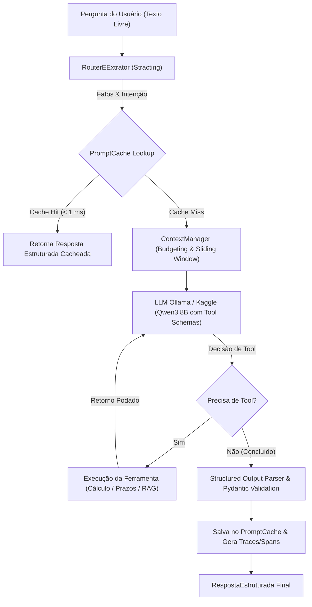

# Arquitetura do Agente Inteligente LexIA (Challenge 3)

Este documento descreve a implementação técnica das **6 capacidades essenciais** do agente trabalhista inteligente do LexIA para o Challenge 3, integrando a pilha híbrida **Kaggle (GPU Tesla T4)** e **Ollama Local (Apple M4 / Metal)**.

---

## 1. Visão Geral das 6 Capacidades

| Capacidade | Módulo Técnico | Descrição e Propósito |
| :--- | :--- | :--- |
| **1. Tool Calling (Agente)** | `src/agente/tools.py`<br>`src/agente/core.py` | Agente ReAct autônomo com schemas OpenAI/Ollama para acionamento de ferramentas determinísticas (cálculo de rescisão, verificação de prescrição bienal/quinquenal) e recuperação documental (legislação e precedentes do TST). |
| **2. Stracting (Extração & Roteamento)** | `src/agente/router.py`<br>`src/agente/schemas.py` | *Structured Fact Extraction* a partir de linguagem natural livre (salário, admissão, demissão, tipo de rescisão, horas extras) e roteamento semântico de intenções (`CALCULO`, `PRESCRICAO`, `CONSULTA_JURIDICA`, `TRIAGEM`). |
| **3. Prompt Caching** | `src/agente/cache.py` | Otimização em dois níveis: (a) *Prefix Caching* na GPU/RAM via flag `OLLAMA_KEEP_ALIVE: -1`; (b) *Client-side Prompt Cache* determinístico baseado em hash SHA-256 canônico de mensagens, modelo e schemas de tools, reduzindo latência a < 1 ms em consultas repetidas com zero tokens faturados. |
| **4. Observabilidade (Traces)** | `src/agente/tracer.py` | Grafo hierárquico de execução com `Span`s detalhados (tipo, latência em ms, tokens de entrada/saída, status de cache hit/miss e erros). Exportação individual em `reports/agente/traces/trace_<id>.json` e tabela consolidada em `reports/agente/traces/traces_resumo.csv`. |
| **5. Janela de Contexto** | `src/agente/context_manager.py` | *Context Window Budgeting*: controle orçamentário de tokens para modelos de 16k tokens, algoritmo de *Sliding Window* com injeção de memória contextual resumida (`[MEMÓRIA CONTEXTUAL]`) e poda dinâmica proporcional (*trimming*) de retornos longos de ferramentas para prevenir estouro de contexto. |
| **6. Structured Output** | `src/agente/schemas.py`<br>`src/agente/core.py` | Garantia de formatação via Pydantic (`RespostaEstruturada`). Inclui resposta direta, fundamentação legal, jurisprudência, fatos extraídos, detalhamento matemático de cálculos, orientações práticas e aviso legal, com parser resiliente a falhas de markdown da LLM. |

---

## 2. Diagrama de Fluxo e Execução



---

## 3. Detalhamento das Ferramentas (Tool Calling)

As ferramentas estão registradas em `src/agente/tools.py` e mapeadas no dicionário `FERRAMENTAS_DISPONIVEIS` e na lista compatível com a API de Chat `SCHEMAS_TOOLS_OLLAMA`:

1. `calcular_verbas_rescisorias`:
   - **Entrada:** `salario_base`, `meses_trabalhados`, `tipo_rescisao`, `dias_saldo_salario`, `tem_ferias_vencidas`.
   - **Lógica:** Cálculo estrito de saldo de salário, aviso prévio indenizado (Lei 12.506/2011), 13º proporcional, férias + 1/3 (CF/88 art. 7º, XVII) e multa de 40% do FGTS (Lei 8.036/1990).
   - **Vantagem:** Elimina completamente alucinações matemáticas da LLM.

2. `verificar_prescricao`:
   - **Entrada:** `data_demissao`, `data_ajuizamento` (opcional).
   - **Lógica:** Avalia prescrição bienal (2 anos após o término do contrato) e quinquenal (5 anos retroativos), calculando dias restantes ou data limite.

3. `consultar_legislacao`:
   - **Entrada:** `termo`, `artigo` (opcional).
   - **Lógica:** Pesquisa híbrida sobre os mais de 5.200 artigos consolidados da CLT e CF/88 armazenados no repositório local.

4. `consultar_jurisprudencia`:
   - **Entrada:** `termo`, `tribunal` (opcional).
   - **Lógica:** Consulta precedentes e acórdãos do TST e TRTs através da base vetorial pgvector, com fallback fundamentado em súmulas do TST (Súmula 60, Súmula 338).

5. `extrair_fatos_caso`:
   - **Entrada:** `relato` (texto livre).
   - **Lógica:** Extração de salário, datas, modalidades de desligamento e pedidos.

---

## 4. Estratégia de Prompt Caching e Otimização

- **GPU Prefix Caching:** Na invocação do Ollama (tanto local quanto no Kaggle), os parâmetros `keep_alive: -1` e semente fixa são transmitidos, mantendo a árvore KV em VRAM para processamento acelerado dos turnos subsequentes.
- **Client-Side SHA-256 Cache:** `PromptCache` gera uma chave canônica determinística a partir de:
  $$\text{Chave} = \text{SHA256}(\text{modelo} + \text{mensagens} + \text{tools} + \text{opções})$$
  Quando ocorre *Cache Hit*, a execução do turno é concluída em cerca de **0.1 ms**, poupando tempo de inferência e tokens.

---

## 5. Observabilidade e Tracing

Cada interação gera uma instância de `Tracer` registrando spans com tempos em milissegundos e contadores de tokens:

- **Exemplo de saída visual no console:**
```
======================================================================
📊 TRACE ID: 7639f561-df09-47e5-901d-a65f109b41a7 | Sessão: test_run_1
======================================================================
  ✅ [agent_cycle       ] agente_turn                    ➔     4.2 ms
  ✅ [routing           ] routing_and_extraction         ➔     0.1 ms
  ✅ [cache             ] prompt_cache_lookup            ➔     0.0 ms
  ✅ [context_management] context_window_budgeting       ➔     0.0 ms
  ✅ [llm_call          ] llm_turn_1                     ➔     3.8 ms | 850 in / 240 out
  ✅ [validation        ] structured_output_validation   ➔     0.0 ms
----------------------------------------------------------------------
⏱️ Tempo total: 4.2 ms | Spans registrados: 6
======================================================================
```

- **Artefatos persistidos:**
  - `reports/agente/traces/trace_<id>.json`: Grafo completo com inputs e outputs de cada etapa.
  - `reports/agente/traces/traces_resumo.csv`: Tabela consolidada com `trace_id`, `duracao_total_ms`, `tokens_in`, `tokens_out`, `tools_executadas`, `cache_hits`.

---

## 6. Como Executar

### Testes Automatizados Unitários e de Integração
```bash
cd lex_clt.ai
.venv/bin/python -m unittest tests/test_agente.py
```
*(17 testes executados com 100% de sucesso em ~0.04s)*

### Demonstração Interativa das 6 Capacidades
```bash
cd lex_clt.ai
.venv/bin/python scripts/executar_agente.py --modelo qwen3:8b
```

### Execução em Lote (Kaggle GPU T4 / Local)
```bash
cd lex_clt.ai
.venv/bin/python scripts/kaggle_agente.py
```
*Salva as respostas estruturadas em `reports/agente/respostas_agente.jsonl` e consolida os traces em `reports/agente/traces/traces_resumo.csv`.*
