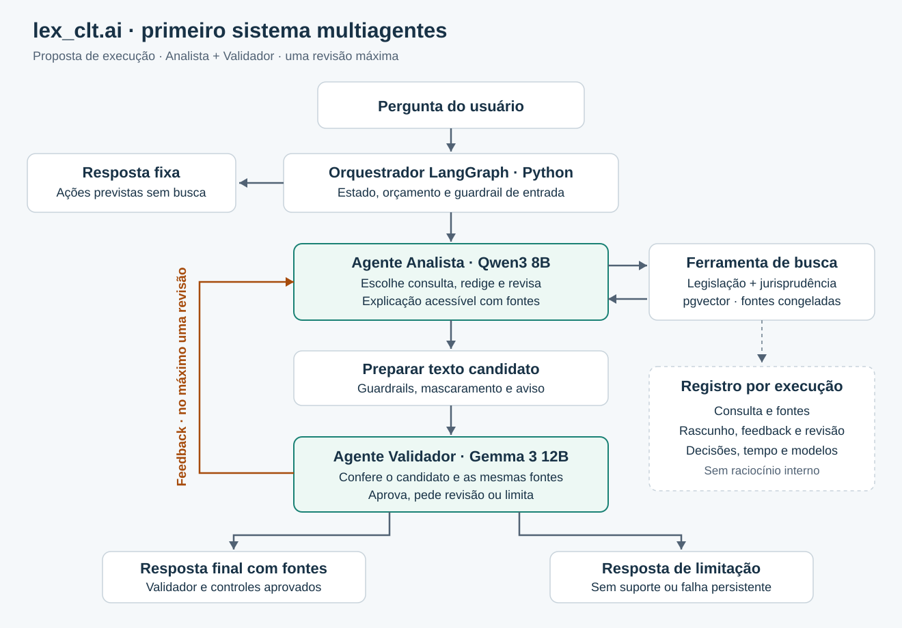
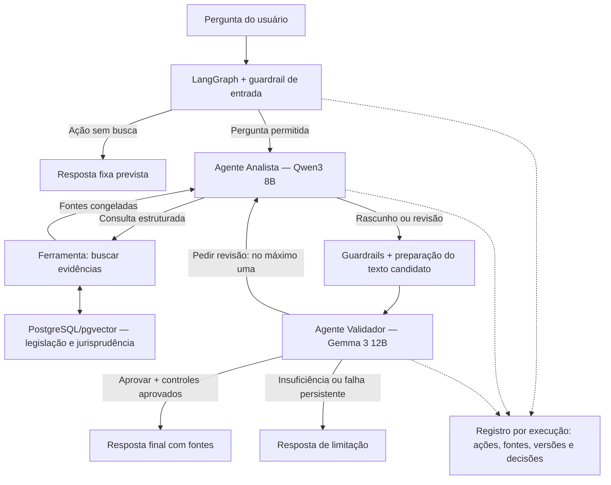

# Guia de execução — primeiro sistema multiagentes do lex_clt.ai

**Data:** 17/11/2026  
**Finalidade:** orientar a implementação, a documentação e a demonstração da atividade da semana.  
**Situação:** guia de planejamento com primeira implementação disponível. Analista, Validador, orquestrador, ferramentas, CLI e testes estão em `src/multiagentes/`. O estado atual e os comandos efetivos estão em [Sistema multiagentes](sistema_multiagentes.md). Este guia não registra inferência Qwen/Gemma concluída.

**Framework escolhido para o plano:** LangGraph em Python, usando `StateGraph` para organizar estado, ferramentas, agentes e retorno de revisão.

## 1. O que entregar nesta semana

Construir um protótipo que responda a uma pergunta trabalhista com dois agentes especializados:

1. **Agente Analista:** escolhe uma consulta, solicita evidências à ferramenta de recuperação e redige uma explicação acessível.
2. **Agente Validador:** verifica a explicação contra as mesmas evidências e decide aprovar, solicitar revisão ou declarar insuficiência de evidência.

Se o Validador pedir uma correção, o Analista recebe o feedback e pode revisar a resposta **uma única vez**. A nova versão passa por outra validação antes de ser apresentada.

| Exigência da atividade | Evidência a entregar |
|---|---|
| No mínimo dois agentes especializados | Dois papéis com instruções, entradas, decisões e saídas próprias |
| Diagrama da arquitetura | Diagrama da seção 3, atualizado conforme a implementação final |
| Responsabilidades | Tabela da seção 4 e instruções versionadas dos agentes |
| Interação e colaboração | Fluxo implementado, feedback estruturado e histórico das etapas |
| Demonstração completa | Pergunta → busca → rascunho → validação → revisão quando necessária → resultado |

**Limite de escopo:** a apresentação pode acontecer em notebook ou terminal. Interface web, API pública, upload de processos, OCR, treinamento de modelos e novos embeddings ficam para etapas posteriores. A recuperação pronta será reaproveitada.

## 2. O que já existe e o que precisa ser criado

O projeto já tem recuperação, geração e avaliação por modelos. A entrega desta semana acrescenta a coordenação e a troca de feedback entre os agentes.

| Componente existente | Como reaproveitar | Trabalho novo |
|---|---|---|
| `src/integracao/recuperacao.py` | `Recuperador.buscar()` consulta legislação e jurisprudência | Expor como ferramenta restrita ao Analista |
| `src/integracao/geracao.py` | `fonte_para_prompt()`, respostas fixas e opções do Qwen | Separar busca, redação e revisão; criar pedidos por etapa |
| `src/integracao/prompt_juridico.py` | Prompt jurídico do grupo e `build_rag_prompt()` | Acrescentar instruções de papel e contrato estruturado sem alterar o prompt original |
| `src/integracao/guardrails.py` | Classificação, mascaramento e verificação das respostas | Integrar os resultados ao controle de liberação |
| `src/integracao/juiz.py` | Critérios de fidelidade, clareza e comportamento | Criar contrato de feedback com revisão e validação rígida |
| Scripts locais e do Kaggle | Transporte dos pedidos e resultados de inferência | Criar execução das etapas com estado e encaminhamento do feedback |

**Atenção às APIs atuais:** `montar_pedido()` já executa a busca; chamá-lo depois da ferramenta duplicaria a recuperação. A classe `Juiz` atualmente usa a API DeepSeek; ela não é um cliente local do Gemma. O validador de JSON atual verifica apenas campos e veredito: os contratos novos devem verificar também tipos, valores e referências.

## 3. Arquitetura proposta





O **orquestrador será um grafo LangGraph em Python**, responsável por encaminhar etapas e impor limites. Busca, banco, embeddings e guardrails são ferramentas e controles auxiliares; os dois agentes são o Analista e o Validador.

A proposta usa um fluxo supervisionado com autonomia limitada: o Analista escolhe a consulta e decide como usar as evidências; o Validador decide se a resposta precisa mudar. A estrutura é inspirada no ciclo de geração, avaliação e feedback descrito pela Anthropic; a classificação da arquitetura aqui é uma escolha deste projeto. [Referência conceitual](https://www.anthropic.com/research/building-effective-agents).

### 3.1 Por que LangGraph

LangGraph permite definir estado compartilhado, nós Python e transições condicionais. Isso se ajusta ao circuito de redação, validação e revisão proposto. Podemos chamar o recuperador e o cliente Ollama dentro dos nós, preservando os componentes existentes. A documentação informa que LangChain não é obrigatório para usar LangGraph. [Visão geral](https://docs.langchain.com/oss/python/langgraph/overview), [Graph API](https://docs.langchain.com/oss/python/langgraph/graph-api).

O Google ADK também é uma alternativa válida e integra modelos Ollama por LiteLLM. Para esta entrega, a escolha de LangGraph é uma decisão de projeto baseada no controle explícito do fluxo; não decorre de uma limitação do ADK aos modelos Gemini. [ADK com Ollama](https://github.com/google/adk-docs/blob/main/docs/agents/models/ollama.md).

Usar um estado tipado contendo pergunta, fontes, rascunho, feedback, revisão e contadores. Representar entrada, consulta, busca, redação, controles, validação e encerramento como nós; as arestas condicionais encaminham aprovação, revisão e insuficiência. Um agente pode ocupar mais de um nó: consulta, redação e revisão continuam pertencendo ao Analista.

Na primeira demonstração, o estado pode permanecer em memória durante a execução, com eventos exportados em arquivos. Retomada após reiniciar o processo exige configurar e testar um mecanismo persistente de checkpoints; não deve ser presumida apenas pela adoção do framework. LangSmith não faz parte do escopo mínimo.

## 4. Responsabilidades e limites

| Item | Agente Analista | Agente Validador |
|---|---|---|
| Objetivo | Produzir explicação compreensível e apoiada nas fontes | Identificar falhas e decidir o encaminhamento |
| Modelo inicial | `qwen3:8b-q8_0` | `gemma3:12b` |
| Recebe | Pergunta sanitizada, ação de entrada e contrato da ferramenta; depois fontes e eventual feedback | Pergunta sanitizada, ação de entrada, fontes, texto candidato e alertas |
| Faz | Formula consulta, seleciona evidências pertinentes, redige e corrige | Confere citações, suporte das afirmações, limitações, comportamento e clareza |
| Decide | Qual consulta usar; responder com suporte ou informar insuficiência; como corrigir | `aprovar`, `revisar` ou `evidencia_insuficiente` |
| Ferramentas/contexto | Uma chamada a `buscar_evidencias`; revisão com as fontes congeladas | Leitura das mesmas fontes e resultados dos guardrails |
| Não pode | Inventar referência, executar SQL livre ou acrescentar fatos jurídicos sem fonte | Aprovar usando conhecimento externo ou reescrever silenciosamente a resposta |
| Saída | Ação estruturada ou resposta com citações | Feedback estruturado com falhas verificáveis |

O Analista também adapta a linguagem ao público trabalhador. Um terceiro agente de comunicação pode ser acrescentado depois, se a avaliação mostrar necessidade.

Na execução normal, **o Validador não recebe resposta-ouro**. Gabaritos e revisões humanas servem à calibração e à avaliação experimental, separadas da demonstração do atendimento.

## 5. Fluxo de uma execução

1. **Receber a pergunta.** Criar `run_id`, registrar a configuração e aplicar `verificar_entrada()`.
2. **Tratar o encaminhamento.** Ações institucionais, consultas individuais sem acesso, outros assuntos e outras jurisdições usam respostas fixas já previstas. Aplicar os controles pertinentes e encerrar. As ações `responder` e `orientar_sem_aconselhar` seguem para os agentes.
3. **Pedir uma ação ao Analista.** Ele recebe a pergunta sanitizada e o contrato da ferramenta, e produz a consulta estruturada.
4. **Executar a ferramenta em Python.** Validar o nome e os argumentos e chamar `Recuperador.buscar()`. O texto do modelo nunca será executado como código.
5. **Congelar as fontes.** Converter com `fonte_para_prompt()` e guardar ordem, texto, metadados, identificadores e hash em um snapshot.
6. **Produzir o rascunho.** Devolver as fontes ao Analista, que responde ou registra insuficiência. Se a ação for orientação sobre caso concreto, preservar a instrução de explicar a regra geral sem prever resultado.
7. **Preparar o candidato.** Aplicar guardrails, mascaramento e aviso previstos. Registrar a versão anterior e a versão candidata separadamente.
8. **Validar.** O Validador examina exatamente o candidato à entrega, as mesmas fontes e os alertas. Devolve decisão e feedback.
9. **Decidir o próximo passo.** Aprovação do Validador e dos controles permite liberação. Falhas corrigíveis retornam ao Analista, se a revisão ainda estiver disponível. Falta de suporte encerra com explicação da limitação.
10. **Revisar e revalidar.** O Analista recebe feedback concreto e corrige com as mesmas fontes. Reaplicar todos os controles e o Validador. Persistindo problemas, não apresentar o rascunho.
11. **Salvar o resultado.** Registrar resposta final ou limitação, status, mensagens operacionais e consumo observado.

**Regra de liberação:** `guardrails.aprovada == True` **e** `validador.decisao == "aprovar"`. A existência de `resposta_final` no retorno dos guardrails não significa aprovação. Se qualquer transformação alterar o candidato depois de validado, ele precisa ser verificado novamente.

## 6. Contratos entre os componentes

### 6.1 Ferramenta do Analista

Exemplo ilustrativo da ação a ser produzida pelo modelo:

```json
{
  "acao": "buscar_evidencias",
  "argumentos": {
    "consulta": "regras gerais sobre férias do trabalhador"
  }
}
```

Implementar uma lista de ferramentas permitidas com apenas `buscar_evidencias`. Validar consulta não vazia, tamanho máximo de 400 caracteres e mascaramento antes da busca. As opções de banco, modelos e cotas são controladas pelo Python.

Usar explicitamente esta configuração existente:

```python
from src.integracao.recuperacao import Configuracao

config = Configuracao(
    entrega_por_fonte={"legislacao": 3, "jurisprudencia": 3},
    cota_por_fonte=10,
    top_k=10,
    reranker_max_length=256,
    lexical_modo="idf",
)
```

As cotas entregam **até** três unidades por fonte. `Configuracao()` sem parâmetros não ativa essa reserva. A ferramenta deve informar o que recuperou, sem afirmar que toda fonte é pertinente.

### 6.2 Saída do Analista

Definir as ações `buscar_evidencias`, `responder` e `evidencia_insuficiente`, com campos obrigatórios próprios para cada uma. O texto de resposta deve manter as citações `[Fonte N]` do projeto. Validar o JSON antes de extrair o texto a ser analisado pelos guardrails.

Preservar `SYSTEM_PROMPT_LEGAL`. Criar instruções próprias para o envelope JSON, o papel e o uso da ferramenta. O prompt da revisão deve incluir pergunta, fontes, rascunho anterior e feedback; não basta repetir o pedido inicial.

### 6.3 Feedback do Validador

Exemplo ilustrativo de um problema de citação:

```json
{
  "decisao": "revisar",
  "evidencia_suficiente": true,
  "problemas": [
    {
      "codigo": "citacao_inexistente",
      "trecho": "Afirmação acompanhada de [Fonte 99].",
      "fontes": [],
      "correcao_solicitada": "Use uma fonte entregue que sustente a afirmação ou remova a afirmação."
    }
  ],
  "resumo": "Há uma referência que não pertence às fontes recebidas."
}
```

Validar tipos, enum de decisões, limites de tamanho e índices de fontes. Para esta primeira versão, todo item em `problemas` representa uma correção obrigatória: `aprovar` exige lista vazia e `evidencia_suficiente=true`; `revisar` exige evidência suficiente e ao menos uma correção acionável; `evidencia_suficiente=false` exige `evidencia_insuficiente`. Observações opcionais ficam no resumo, sem contrariar a decisão. Notas herdadas da rubrica devem aceitar somente 0, 1, 2 ou nulo quando aplicável. JSON inválido é falha de contrato, nunca aprovação implícita.

### 6.4 Estado e rastreabilidade

Guardar por execução: `run_id`, modo real ou sintético, pergunta sanitizada, ação de entrada, consulta, snapshot das fontes, modelos e versões de prompt, rascunho, candidato, feedback, revisão, resultado, contadores, tempos e uso de cache.

`[Fonte N]` é uma posição, não um ID persistente. Manter a ordem e o conteúdo das fontes durante todo o ciclo. Para esta semana haverá **uma busca inicial e uma revisão textual**, sem nova recuperação depois do feedback.

Registrar ações e justificativas curtas, sem solicitar ou gravar raciocínio interno dos modelos. Evidências reais e perguntas protegidas devem ficar nos diretórios privados já previstos ou em novos diretórios explicitamente ignorados pelo Git.

## 7. Preparar o ambiente

### 7.1 Escolher o modo da demonstração

| Modo | Dependências | O que comprova |
|---|---|---|
| Real, recomendado para o contexto do projeto | Banco populado, BGE-M3, reranker e dois modelos de linguagem | Colaboração sobre as bases jurídicas já construídas |
| Sintético de desenvolvimento | Pequenas fontes fictícias e os dois modelos de linguagem | Ferramenta, troca de feedback, revisão e controle de término |
| Reprodução de execução gravada | Arquivos de uma execução real anterior | Inspeção de uma execução; identificar explicitamente como reprodução |

O modo sintético precisa estar identificado como teste e não deve apresentar regras inventadas como legislação real. Respostas simuladas de modelos ajudam nos testes de código, mas não comprovam inferência dos agentes.

### 7.2 Instalar as dependências existentes

Executar na raiz do repositório. Os comandos desta subseção já correspondem a arquivos existentes.

```bash
python3 -m venv .venv
source .venv/bin/activate
python -m pip install -r requirements.txt -r requirements-chunking-jurisprudencia.txt
```

No Windows, criar o ambiente com `python -m venv .venv` e ativar com `.venv/Scripts/Activate.ps1`.

**Dependência nova da implementação:** instalar LangGraph no mesmo ambiente:

```bash
python -m pip install langgraph
```

A primeira implementação foi testada com Python 3.14.6 e declara LangGraph 1.2.22 em `requirements-multiagentes.txt`. Para reproduzir essa configuração, usar `python -m pip install -r requirements-multiagentes.txt`.

### 7.3 Preparar o banco para o modo real

Com Docker iniciado:

```bash
python scripts/configure_local_pgvector.py
docker compose --env-file .env.pgvector.local -f compose.pgvector.yaml up -d
```

Esse procedimento cria a infraestrutura; **um contêiner novo tem um banco vazio**. Restaurar uma cópia do banco do ambiente original ou reconstruir e importar as coleções pelos pipelines já documentados. Criar credenciais apenas na configuração inicial, sem sobrescrever a conexão de um banco existente.

A recuperação exige os datasets A e D da legislação com os IDs esperados pelo módulo e exatamente um dataset de jurisprudência em estado `validado`. Os caches BGE-M3 e reranker também precisam estar disponíveis localmente. O clone, sozinho, não contém esses recursos nem todos os dados de jurisprudência.

Verificar a recuperação antes de implementar os agentes:

```python
from pathlib import Path
from src.storage.pgvector_store import load_database_url
from src.integracao.recuperacao import Recuperador, Configuracao

database_url = load_database_url(Path(".env.pgvector.local"))
recuperador = Recuperador(database_url, device="cpu")
try:
    print(recuperador.preparar_lexico())
    fontes, diagnostico = recuperador.buscar(
        "Quais são as regras gerais sobre férias?",
        Configuracao(entrega_por_fonte={"legislacao": 3, "jurisprudencia": 3}),
    )
    print("Fontes:", len(fontes), "Tempo:", diagnostico["segundos"])
finally:
    recuperador.fechar()
```

Esse trecho lê o banco e cria as visões/índices lexicais quando ainda não existem. Se versões dos datasets mudarem, conferir também a atualização dessas visões. Não copiar credenciais para notebooks ou relatórios.

### 7.4 Preparar os modelos

No ambiente escolhido para inferência, iniciar o Ollama e disponibilizar os modelos já adotados pelo projeto:

```bash
ollama pull qwen3:8b-q8_0
ollama pull gemma3:12b
ollama list
```

Os downloads exigem rede e armazenamento. Confirmar memória e tempo de execução com um caso pequeno; o guia não presume que os modelos caibam simultaneamente na máquina.

Criar um cliente para `POST /api/chat`, usando `stream=false`, temperatura 0 e formato estruturado. A API documenta JSON/schema e o parâmetro `keep_alive`; ainda é necessário validar a resposta no Python. Verificar a compatibilidade com a versão instalada antes de adotar esses parâmetros. [API Chat](https://docs.ollama.com/api/chat), [saídas estruturadas](https://docs.ollama.com/capabilities/structured-outputs).

Executar Qwen e Gemma sequencialmente e descarregar o modelo anterior antes de trocar, conforme a capacidade do ambiente. `keep_alive=0` solicita descarregamento após a chamada. O kernel atual usa `OLLAMA_KEEP_ALIVE=-1` e precisa ser adaptado para esse cenário. Manter o Qwen sem saída de raciocínio e não enviar opções de raciocínio ao Gemma sem verificar suporte.

## 8. Implementação em etapas

Os caminhos abaixo organizam a implementação inicial. Consulte o [relatório da implementação](sistema_multiagentes.md) para distinguir testes de controle e execução com modelos reais.

| Ordem | Arquivo ou entrega nova | Conteúdo e condição para avançar |
|---|---|---|
| 1 | `src/multiagentes/contratos.py` e `__init__.py` | Estado, decisões, snapshots e validação das mensagens |
| 2 | `src/multiagentes/cliente_llm.py` | Adaptador Ollama com timeout, formato estruturado e registro de consumo |
| 3 | `src/multiagentes/ferramentas.py` | Ferramenta de busca real e alternativa sintética com a mesma interface |
| 4 | `src/multiagentes/analista.py` | Escolha da consulta, redação e revisão com feedback |
| 5 | `src/multiagentes/validador.py` | Verificação com fontes, critérios e decisões estruturadas |
| 6 | `src/multiagentes/orquestrador.py` | `StateGraph` com estado tipado, nós Python, arestas condicionais, uma revisão e regras de término |
| 7 | `scripts/executar_multiagentes.py` | CLI para uma pergunta e seleção explícita do modo |
| 8 | `tests/test_multiagentes.py` | Testes de transição, contratos, fontes e bloqueio de saída |
| 9 | `notebooks/04_multiagentes/01_demonstracao_multiagentes.ipynb` | Execução legível, mensagens entre agentes e comparação das versões |
| 10 | `docs/sistema_multiagentes.md` | Arquitetura, responsabilidades, comandos e limitações observadas |

Os prompts podem ficar como constantes nos módulos dos agentes ou em arquivos próprios versionados. O notebook e a CLI devem chamar o mesmo grafo compilado, evitando duplicar o fluxo. Instanciar clientes e conexões como recursos de execução; não gravar conexões, senhas ou objetos de modelos no estado serializado.

**Limites iniciais propostos:** uma busca, uma revisão semântica e seis chamadas de LLM no total por pergunta, incluindo no máximo uma tentativa técnica adicional. O caminho normal usa três chamadas: consulta do Analista, redação e validação. Com revisão, usa cinco. Consumir o orçamento também em erros; não reiniciar os contadores. Definir timeout por chamada e um teto de duração por execução ajustado após o ensaio.

Conferir orçamento de contexto com pergunta, fontes, instruções e feedback. Se não couber, reduzir explicitamente a seleção antes de congelar o snapshot ou encerrar com limitação; não cortar evidências silenciosamente.

Falha de banco, timeout ou contrato inválido deve gerar status de **falha técnica**. Falta de suporte deve gerar **evidência insuficiente**. Uma resposta bloqueada pelo Validador não pode ser exibida como resposta final.

### Interface de execução a implementar

A CLI está disponível na implementação inicial:

```bash
python scripts/executar_multiagentes.py --modo real --pergunta "Quais são as regras gerais sobre férias?"
python scripts/executar_multiagentes.py --modo sintetico --caso revisao_controlada
python -m unittest discover -s tests -p "test_multiagentes.py" -v
```

Definir saída por `run_id`, contendo manifesto, eventos, fontes, versões da resposta e avaliações. Antes de gravar evidências reais, configurar a exclusão desse diretório no Git.

## 9. Alternativa de execução no Kaggle

**Ambiente escolhido para a primeira demonstração:** Kaggle. A implementação inicial oferece um notebook que executa o grafo inteiro na GPU, com uma busca lexical em um corpus portátil da legislação disponível no projeto. Prepare o pacote com `python scripts/preparar_multiagentes_kaggle.py --tema ferias` e siga o [roteiro do Kaggle](execucao_multiagentes_kaggle.md).

O pacote não inclui o banco pgvector nem os embeddings. Para usar especificamente a busca do banco local com inferência remota, o fluxo em lotes abaixo permanece uma alternativa de evolução; essa coordenação remota não foi implementada.

1. Qwen produz a consulta do Analista e exporta a ação estruturada.
2. O ambiente local executa a recuperação e congela as fontes.
3. Qwen recebe as fontes e gera o rascunho. O ambiente local importa e valida o contrato, aplica guardrails, mascaramento e aviso, e exporta o candidato exato para validação.
4. Gemma valida esse candidato e devolve feedback, que é importado e verificado localmente.
5. Se necessário, Qwen recebe o feedback e revisa. O ambiente local valida o novo contrato, reaplica os controles e exporta o novo candidato; só então Gemma valida novamente.
6. O ambiente local importa a decisão final, aplica a regra de liberação e monta o histórico. Nenhuma alteração posterior do candidato pode dispensar nova verificação.

Essa modalidade é assíncrona. O kernel atual não tem acesso direto ao PostgreSQL local. Usar a própria conta e parametrizar usuário, dataset e kernel; os scripts existentes contêm identificadores do ambiente original. Preparar a apresentação a partir de uma execução real salva, informando quando houver reprodução.

## 10. Como verificar o funcionamento

Começar com testes de código usando modelos substitutos e fontes fictícias; depois executar os dois modelos reais. Os testes de controle precisam demonstrar comportamento observável:

- Aprovação encerra e entrega somente a versão validada.
- Revisão encaminha o feedback ao Analista e valida a nova versão.
- Segunda reprovação encerra sem liberar o texto bloqueado.
- Guardrail bloqueante impede liberação mesmo com aprovação do Validador.
- Fonte inexistente, JSON inválido e orçamento esgotado têm saídas definidas.
- Fontes e identificadores permanecem iguais entre rascunho e revisão.
- Falta de evidência e falha técnica recebem estados diferentes.

Comparar Analista sozinho e Analista com Validador nas mesmas perguntas e fontes. Registrar quantidade de casos, aprovação humana, correções úteis, revisões desnecessárias, tempo e chamadas. Não pressupor que a revisão melhora toda resposta.

As nove revisões humanas históricas podem apoiar calibração; depois desse uso, não constituem teste independente da versão ajustada. Reservar perguntas novas para avaliar a entrega final.

## 11. Roteiro da demonstração

**Duração sugerida:** 6 a 8 minutos. Usar perguntas gerais e fontes sem dados pessoais desnecessários.

| Caso | Pergunta ou preparação | O que mostrar |
|---|---|---|
| Resposta fundamentada | “Quais são as regras gerais sobre férias?”; usar fontes reais ou fixture identificada | Consulta escolhida pelo Analista, retorno da ferramenta, citações e avaliação |
| Revisão controlada | Após o primeiro rascunho, trocar uma citação por `[Fonte 99]` no mecanismo de teste | Problema registrado, feedback, resposta revisada e segunda validação |
| Sem evidência | Pergunta sobre banco de horas com ferramenta de teste retornando fontes vazias ou de outro tema | Reconhecimento da insuficiência, sem inventar regras |
| Fora do escopo | “Como rescindir um contrato de aluguel residencial?” | Encaminhamento previsto e ausência de chamadas desnecessárias aos agentes |

A falha inserida deve aparecer como `falha_injetada=true`. Ela demonstra o controle do fluxo e não mede a frequência natural de erros. Preservar o rascunho original antes da alteração. Um caso natural de revisão, quando encontrado, pode complementar esse teste.

Sequência da apresentação:

1. Explicar o objetivo e apresentar o diagrama e os dois papéis.
2. Executar uma pergunta e mostrar consulta, fontes, rascunho e decisão.
3. Exibir o caso de revisão: `Analista v0 → Validador v0 → feedback → Analista v1 → Validador v1`.
4. Mostrar o antes e depois e confirmar que o feedback foi recebido pelo Analista.
5. Exibir uma limitação e encerrar com os resultados efetivamente medidos.

Os exemplos deste guia descrevem comportamento esperado; ainda não são resultados do sistema.

## 12. Organização sugerida para a semana

| Etapa | Atividade | Resultado verificável |
|---|---|---|
| Dia 1 | Confirmar ambiente, definir contratos e preparar fontes de teste | Busca ou ferramenta sintética funcionando; contratos definidos |
| Dia 2 | Implementar Analista e cliente de modelos | Consulta e rascunho produzidos com fontes |
| Dia 3 | Implementar Validador e orquestrador | Feedback retorna ao Analista; uma revisão e novo julgamento |
| Dia 4 | Testar controles e ensaiar com modelos reais | Casos registrados; falhas e tempos conhecidos |
| Dia 5 | Consolidar documentação e demonstração | Notebook executado, relatório e roteiro prontos |

Em equipe, distribuir contratos/orquestração, Analista/ferramenta e Validador/avaliação em paralelo após combinar os formatos. Se uma pessoa executar tudo, seguir a mesma ordem.

## 13. Checklist de conclusão

- [ ] Dois agentes especializados implementados, com instruções e decisões distintas.
- [ ] Consulta da ferramenta escolhida pelo Analista e executada pelo Python.
- [ ] Evidências recuperadas e identificadores preservados em snapshot.
- [ ] Validador verifica a resposta com as mesmas evidências, sem gabarito na execução.
- [ ] Feedback estruturado retorna ao Analista e influencia uma revisão demonstrável.
- [ ] Revisão passa novamente pelos guardrails e pelo Validador.
- [ ] Falhas persistentes, insuficiência e erros técnicos encerram de forma definida.
- [ ] Diagrama, responsabilidades e fluxo correspondem ao código entregue.
- [ ] Notebook ou terminal demonstra um fluxo completo com os dois modelos.
- [ ] Resultados reais, testes controlados e reproduções estão identificados.
- [ ] Relatório informa ambiente, limites, casos executados e resultados observados.

## 14. Referências para implementação

- [Estado atual da integração](estado_integracao.md).
- [Implementação multiagentes](sistema_multiagentes.md) e [execução no Kaggle](execucao_multiagentes_kaggle.md).
- [Recuperação conjunta](../src/integracao/recuperacao.py).
- [Geração e conversão de fontes](../src/integracao/geracao.py).
- [Prompt jurídico preservado](../src/integracao/prompt_juridico.py).
- [Guardrails](../src/integracao/guardrails.py).
- [Juiz e rubrica atuais](../src/integracao/juiz.py).
- [Preparação do PostgreSQL/pgvector](pgvector.md).
- [Base e índice de jurisprudência](../README.md#notebook-05-e-índice-de-busca).
- [LangGraph — visão geral](https://docs.langchain.com/oss/python/langgraph/overview) e [Graph API](https://docs.langchain.com/oss/python/langgraph/graph-api): framework adotado para a orquestração.
- [Google ADK — modelos Ollama](https://github.com/google/adk-docs/blob/main/docs/agents/models/ollama.md): alternativa considerada.
- [Anthropic — Building effective agents](https://www.anthropic.com/research/building-effective-agents): referência conceitual para ferramentas, limites e ciclo de avaliação.
- [Ollama — Chat API](https://docs.ollama.com/api/chat) e [Structured outputs](https://docs.ollama.com/capabilities/structured-outputs): formato das chamadas e contratos estruturados. Documentação externa consultada em 17/11/2026; validar compatibilidade com a versão efetivamente usada.
