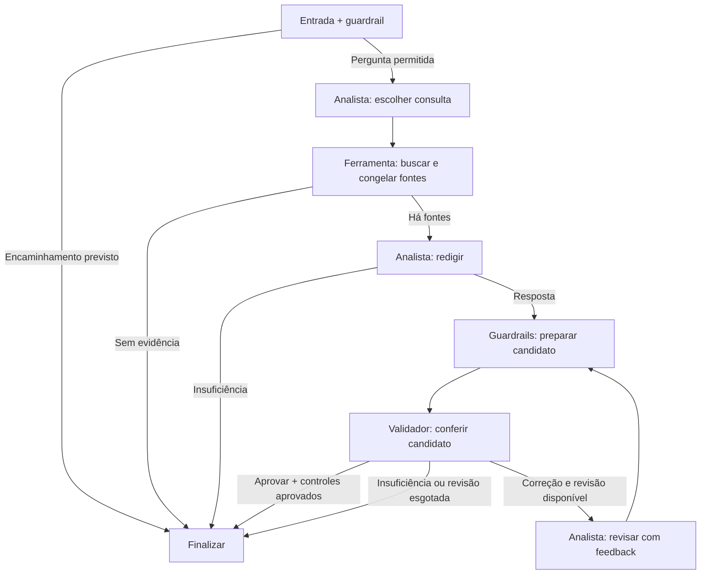

# Sistema multiagentes — implementação inicial

Implementação em Python com LangGraph, baseada no [guia de execução](plano_sistema_multiagentes.md).

## Componentes entregues

| Componente | Responsabilidade |
|---|---|
| [Analista](../src/multiagentes/analista.py) — Qwen3 8B | Escolher a consulta da ferramenta, redigir com fontes e corrigir após feedback |
| [Validador](../src/multiagentes/validador.py) — Gemma 3 12B | Conferir o candidato contra as mesmas fontes e decidir aprovação, revisão ou insuficiência |
| [Orquestrador](../src/multiagentes/orquestrador.py) | Executar o StateGraph, controlar orçamento e impedir saída reprovada |
| [Ferramentas](../src/multiagentes/ferramentas.py) | Recuperação no banco, corpus portátil de legislação ou material fictício |
| [BuscadorLocal](../src/multiagentes/buscador_local.py) | Recuperação semântica no JSON original de artigos completos, com cache SQLite de embeddings |
| [Cliente Ollama](../src/multiagentes/cliente_llm.py) | Inferência estruturada, validação, timeout e descarregamento dos modelos |
| [Registro](../src/multiagentes/registro.py) | Exportar versões, eventos, fontes e manifesto com hashes |

## Fluxo de colaboração



Os agentes têm contextos e instruções separados. A consulta é produzida pelo Analista em JSON e executada pelo Python. O feedback do Validador volta ao Analista junto do candidato anterior. Busca, guardrails e nós de controle não são contados como agentes.

O caminho normal realiza três chamadas de modelo: consulta, redação e validação. Com revisão, realiza cinco. Existe uma tentativa técnica adicional global, respeitando seis chamadas totais; ela é diferente da revisão semântica.

## Primeiro ambiente escolhido: Kaggle

A execução com os modelos usa a GPU do Kaggle. O pacote portátil leva código e um recorte da legislação já presente no repositório, sem depender do PostgreSQL local ou dos embeddings.

Preparar o pacote na raiz do projeto:

```bash
python scripts/preparar_multiagentes_kaggle.py --tema ferias
```

O script não publica nem envia dados. Os arquivos serão criados em `output/kaggle/multiagentes/`, ignorado pelo Git. Siga [Execução dos agentes no Kaggle](execucao_multiagentes_kaggle.md) para criar o dataset privado, importar o notebook, executar e baixar o histórico.

Nesse modo, a ferramenta faz **busca lexical no corpus portátil**. Isso não reproduz a busca híbrida com BGE-M3 e pgvector, que permanece disponível no modo `real`. Os textos e metadados originais são preservados; não há verificação nova de vigência.

## Execução local

O modo local continua disponível para quem tiver os modelos no Ollama.

```bash
python3 -m venv .venv
source .venv/bin/activate
python -m pip install -r requirements-multiagentes.txt
python scripts/executar_multiagentes.py --verificar-ambiente
```

No Windows, usar `python` na criação do ambiente e `.venv/Scripts/Activate.ps1` para ativá-lo.

O diagnóstico informa versões, modelos disponíveis e presença de configuração do banco, sem imprimir credenciais. Código de saída 2 indica modelos indisponíveis ou falha de consulta. A presença de configuração não comprova que o banco esteja acessível.

### Corpus portátil

Com o pacote preparado e os dois modelos no Ollama:

```bash
python scripts/executar_multiagentes.py --modo corpus --corpus output/kaggle/multiagentes/corpus_legislacao.json --pergunta "Quais são as regras gerais sobre férias segundo as fontes fornecidas?"
```

### Material sintético

```bash
python scripts/executar_multiagentes.py --modo sintetico --caso ferias
python scripts/executar_multiagentes.py --modo sintetico --caso revisao_controlada
python scripts/executar_multiagentes.py --modo sintetico --caso sem_evidencia
python scripts/executar_multiagentes.py --modo sintetico --caso fora_escopo
```

Os três primeiros casos usam modelos reais. O material é fictício e não define regras jurídicas. O caso de revisão controlada insere `[Fonte 99]` depois do rascunho e registra `falha_injetada=true`; esse recurso é proibido nos modos `real` e `corpus`.

O caso fora do escopo usa somente o guardrail e uma resposta fixa, sem inferência. Ele verifica encaminhamento e exportação, mas não demonstra colaboração dos agentes.

### Buscador local com embeddings

O modo `local` consulta a base original completa, sem PostgreSQL e sem selecionar um tema fixo. Os caminhos procurados são `dados/processed/legislacao/legislacao_artigos_completos.json` e, como alternativa deste checkout, `data/processed/legislacao/legislacao_artigos_completos.json`. É possível informar outro caminho com `--corpus`.

```bash
python -m pip install -r requirements-buscador-local.txt
python scripts/consultar_buscador_local.py --preparar-indice
python scripts/consultar_buscador_local.py --pergunta "Como funciona o adicional noturno no trabalho urbano?"
python scripts/executar_multiagentes.py --modo local --pergunta "Como funciona o adicional noturno no trabalho urbano?"
```

As duas primeiras operações do buscador não precisam de Ollama. A última executa os agentes e exige seus modelos disponíveis. O índice é preparado antes do orçamento de atendimento; o cache fica em `dados/output/buscador_local/`, ignorado pelo Git. Uma nova instância reutiliza embeddings dos artigos somente se corpus, modelo, revisão e configuração forem compatíveis. O embedding de cada nova consulta continua sendo calculado.

O corpus local disponível foi lido e validado: 5.284 artigos, distribuídos por 25 arquivos de normas. A recuperação usa cosseno e limiar configurável; esses controles não comprovam pertinência ou vigência. Consulte [Buscador local](buscador_local.md) para detalhes de cache, dependências, testes e pacote Kaggle com `--buscador local`.

### Banco original com pgvector

Instalar também `requirements.txt`, disponibilizar modelos BGE-M3/reranker e restaurar o banco já populado conforme [a documentação do banco](pgvector.md).

```bash
python scripts/executar_multiagentes.py --modo real --preparar-lexico --pergunta "Quais são as regras gerais sobre férias?"
```

`--preparar-lexico` cria as visões e índices necessários à busca lexical. Usar na preparação; as consultas normais não executam essa criação. Os datasets A/D de legislação e o dataset validado de jurisprudência precisam existir.

## Saídas e limites

Cada execução cria um diretório novo em `output/multiagentes/<run_id>/`:

- `estado.json`: estado final e histórico das versões.
- `eventos.jsonl`: ações, decisões e contadores.
- `fontes.json`: snapshot ordenado e hash.
- `resposta.txt`: única saída liberada ao usuário.
- `grafo.mmd`: diagrama do grafo executado, quando exportado pela CLI.
- `manifesto.json`: versões e hashes dos artefatos.

Os registros podem conter evidências privadas e são ignorados pelo Git. Eles permitem auditoria; não implementam retomada após reiniciar o processo.

O estado indica um destes resultados:

| Status | Significado |
|---|---|
| `aprovada` | Candidato aprovado pelo Validador e pelos guardrails |
| `limitada` | Evidência insuficiente, contexto excedido ou revisão esgotada |
| `resposta_fixa` | Encaminhamento previsto, sem consulta aos agentes |
| `falha_tecnica` | Transporte, contrato, tempo, orçamento ou ferramenta impediram a execução |

Uma aprovação significa que os controles do protótipo foram atendidos; não constitui certificação jurídica.

Configuração inicial: uma busca, uma revisão, uma tentativa técnica adicional, seis chamadas LLM totais, 180 segundos por chamada e 900 segundos de execução local. O notebook Kaggle ajusta os tempos à inferência na GPU.

Antes do snapshot, o orquestrador seleciona fontes completas até um orçamento inicial de 5.000 bytes, reservando espaço para instruções, candidato e feedback. Fontes omitidas são registradas e não são cortadas. As cotas 3+3 do banco são um máximo; a seleção final pode conter menos unidades. Há também uma conferência conservadora do tamanho do prompt antes da inferência; casos extensos podem encerrar com limitação.

Os modelos são usados sequencialmente, com `keep_alive=0`. O grafo desativa tracing LangSmith durante a execução, mesmo se o ambiente o tiver habilitado. Os testes usam clientes substitutos somente dentro de `tests/`.

## Verificação e demonstração

```bash
python -m unittest discover -s tests -p "test_multiagentes*.py" -v
python -m unittest discover -s tests -p "test_integracao_guardrails.py" -v
python -m unittest discover -s tests -p "test_integracao_juiz.py" -v
```

O [notebook local](../notebooks/04_multiagentes/01_demonstracao_multiagentes.ipynb) permite inspecionar versões e decisões. Os flags de inferência estão desligados por padrão. O notebook do Kaggle é o roteiro para a primeira execução com os modelos.

Na apresentação, mostrar consulta, fontes, rascunho, decisão e, quando houver, feedback e revisão. Diferenciar execução natural, teste com falha inserida e reprodução de registros. Saídas de modelos não são fabricadas nos notebooks versionados.

## Estado observado nesta máquina

Em 17/11/2026, LangGraph 1.2.22 foi instalado e os testes de controle passaram. O diagnóstico local encontrou Ollama 0.32.0 sem modelos e ausência de configuração do banco. A execução de encaminhamento fora do escopo foi conferida pela CLI, com zero chamadas LLM.

A conta foi autenticada pela CLI e a inferência Qwen/Gemma foi executada no notebook privado do Kaggle. A primeira rodada completa registrou cinco chamadas e uma revisão, encerrando com resposta limitada após a segunda reprovação. Depois das correções testadas, a versão 7 foi concluída em 19/11/2026: três chamadas, nenhuma revisão e aprovação do Validador e dos guardrails. As duas rodadas e seus artefatos foram preservados separadamente.

Consulte [Demonstração dos agentes no Kaggle](resultados_multiagentes.md) para os resultados observados. Testes de controle e uma demonstração de desenvolvimento não equivalem a uma avaliação independente da qualidade jurídica.
